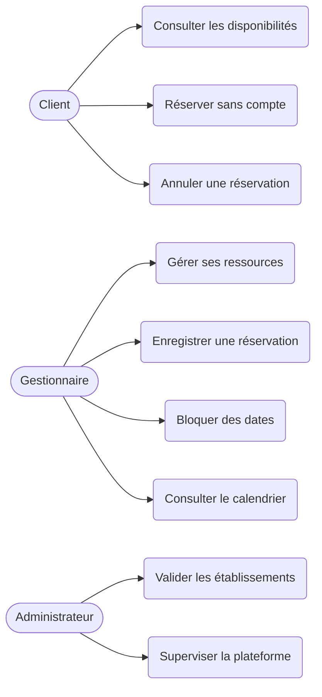

# Cahier des charges : plateforme de réservation

Projet de stage. Version 1.0, 31 octobre 2026.
Auteur : [Ton nom]

## 1. Énoncé du problème

La réservation traditionnelle est lente et manque d'information. Un client doit souvent se déplacer ou appeler pour apprendre que la salle, la table ou la chambre est déjà occupée. Les établissements, de leur côté, perdent des clients et gèrent leurs réservations sans vision fiable des disponibilités.

Cette application permet à toute personne de consulter les disponibilités en temps réel et de réserver à distance, sans compte obligatoire. Elle aide aussi les établissements à gérer leurs réservations sans conflit.

## 2. Objectifs mesurables

- Réduire le temps pour réserver (de plusieurs minutes ou un déplacement à quelques clics).
- Supprimer les déplacements inutiles : la disponibilité affichée doit toujours être exacte.
- Éviter les doubles réservations sur une même ressource et une même période.

## 3. Périmètre de la version 1

- Établissements concernés : salles (conférence, réception) et restaurants.
- Extension prévue ensuite : hôtels et auberges (le moteur de réservation reste le même).
- Aucun compte n'est exigé pour réserver. Le client laisse ses coordonnées (nom, téléphone, e-mail) directement dans la réservation.

## 4. Acteurs

| Acteur | Rôle |
|---|---|
| Client | Toute personne qui veut réserver. Aucun compte requis. |
| Gestionnaire | Responsable d'un établissement : gère ses ressources et ses réservations. |
| Administrateur | Supervise la plateforme et valide les établissements. |

## 5. Diagramme de cas d'utilisation

Une version dessinée du diagramme peut être ajoutée dans `docs/cas-utilisation.png`.

## 6. User stories

1. En tant que client, je veux voir les créneaux libres d'une salle ou d'une table afin d'éviter un déplacement inutile.
2. En tant que client, je veux réserver en ligne afin de gagner du temps.
3. En tant que client, je veux recevoir une confirmation afin d'être sûr que ma place est garantie.
4. En tant que gestionnaire, je veux enregistrer une réservation faite par téléphone afin que le calendrier reste à jour.
5. En tant que gestionnaire, je veux bloquer des dates (travaux, fermeture) afin qu'aucune réservation ne soit acceptée.
6. En tant que client, je veux réserver sans créer de compte afin de gagner du temps.
7. En tant que client, je veux annuler ma réservation afin de libérer le créneau si je ne peux plus venir.
8. En tant que gestionnaire, je veux ajouter mes salles, tables ou chambres avec leur capacité et leur prix afin que les clients les voient.
9. En tant que gestionnaire, je veux voir le calendrier de mes réservations afin de préparer l'accueil.
10. En tant qu'administrateur, je veux valider les établissements inscrits afin d'éviter les faux établissements.

## 7. Classement des fonctionnalités

| Catégorie | Fonctionnalités |
|---|---|
| Indispensables | Liste des ressources, calendrier des disponibilités, réservation sans compte, détection des conflits, annulation, ajout d'une réservation par le gestionnaire (téléphone, comptoir), blocage de dates |
| Utiles | Connexion du gestionnaire, notifications par e-mail ou SMS, historique des réservations, expiration automatique des réservations en attente |
| Bonus | Paiement simulé, réservations récurrentes, statistiques d'occupation, comptes clients |

## 8. Règles de gestion principales

- Une ressource ne peut pas avoir deux réservations actives qui se chevauchent. Deux périodes se chevauchent si `debut1 < fin2` et `debut2 < fin1`.
- Une période bloquée (fermeture, travaux) refuse toute réservation.
- Une réservation a un statut : `en_attente`, `confirmee`, `annulee`, `expiree`.
- Une réservation a une source : `en_ligne`, `telephone`, `comptoir`.
- En cas de demandes simultanées, une transaction avec verrouillage de la ressource garantit qu'une seule réservation est acceptée.
- Une réservation en attente bloque le créneau pendant un délai limité, puis expire.

## 9. Choix techniques

| Couche | Choix |
|---|---|
| Interface | HTML, CSS, JavaScript |
| Serveur | PHP 8.2 avec CakePHP 5.4 (architecture MVC) |
| Base de données | MySQL (MariaDB sous XAMPP) |
| Versionnage | Git et GitHub |
| Tests | PHPUnit |

## 10. Modèle de données (version 1)

- `etablissements` : id, nom, type, adresse, telephone, created, modified.
- `ressources` : id, etablissement_id, nom, type, capacite, prix, created, modified.
- `utilisateurs` : id, nom, email (unique), mot_de_passe (haché), role, created, modified.
- `reservations` : id, ressource_id, utilisateur_id (facultatif), nom_client, telephone_client, email_client, debut, fin, statut, source, created, modified.
- `blocages` : id, ressource_id, debut, fin, motif, created, modified.

Relations : une ressource appartient à un établissement ; une réservation et un blocage portent sur une ressource ; une réservation peut être liée à un utilisateur, mais ce lien est facultatif.

## 11. Planning

| Période | Objectif | Livrable |
|---|---|---|
| Semaine 1 (jusqu'au 6 nov.) | Cadrage | Ce cahier des charges, user stories, cas d'utilisation |
| Semaine 2 | Conception | UML (classes, séquence), maquettes |
| Semaine 3 | Mise en place | Structure MVC, modèles CakePHP |
| Semaines 4-5 | Développement | Ressources, réservation, détection de conflits |
| Semaine 6 | Qualité | Tests PHPUnit, correction des bugs |
| Semaine 7 | Déploiement | Mise en ligne, jeu de données de démonstration |
| Semaine 8 | Finalisation | Rapport, présentation, démo |
